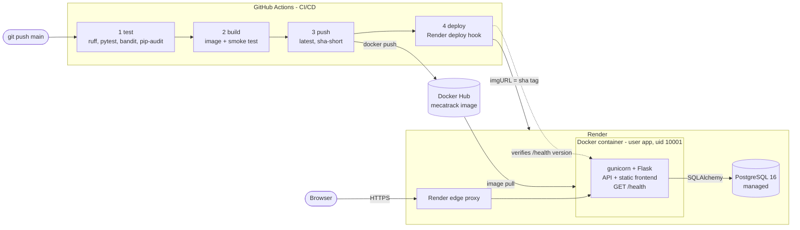

# MecaTrack

[](https://github.com/Pablixsz/MecaTrack/actions/workflows/ci-cd.yml)
[](https://github.com/Pablixsz/MecaTrack/actions/workflows/mecatrack-tests.yml)
[](https://sonarcloud.io/summary/overall?id=Pablixsz_MecaTrack)
[](docs/quality-report.md)
[](https://hub.docker.com/r/<DOCKERHUB_USERNAME>/mecatrack)
[](https://hub.docker.com/r/<DOCKERHUB_USERNAME>/mecatrack)


[](LICENSE)

**Live demo:** <PUBLIC_URL>

MecaTrack is a web system for a car repair workshop. Clients book appointments for their vehicles and pay a
simulated deposit; the system automatically assigns a free service bay and a free mechanic; mechanics record
every step of the repair; and the owner gets a global view of the workshop. It is the final project of the
*Taller de Programación* course, and Lab 8 turns it into a cloud-native application: containerised, tested and
delivered by a four-stage CI/CD pipeline to a public URL.

## Features by role

| Role | What they can do |
|---|---|
| **Client** | Register, add vehicles, browse the service catalog, book an appointment, pay the 30 % deposit (simulated, it confirms the booking), follow the repair status and its history. |
| **Mechanic** | See the appointments assigned to them, change their status and add tracking entries with notes, mileage and the parts used (deducted from inventory). |
| **Owner** | Global dashboard; manage bays, parts, services and mechanics; market analytics with Colombian open data. |
| **Admin** | Reception desk: register walk-in clients and their vehicles and book on their behalf. |

The **scheduling engine** (`backend/domain/scheduling/allocation.py`) picks a bay and a mechanic whose
calendars are free for the whole `[start, end)` interval, so double bookings are impossible (a conflict answers 409).

## Tech stack

| Layer | Technology |
|---|---|
| Frontend | Vanilla HTML, CSS and JavaScript (no frameworks), served by the same Flask process |
| Backend | Python 3.12, Flask 3.1, SQLAlchemy 2.0, Flask-Migrate (Alembic), Flask-JWT-Extended, flask-smorest (OpenAPI) |
| Database | PostgreSQL 16 |
| Runtime | gunicorn (1 worker × 4 threads) in a non-root container |
| Delivery | Docker multi-stage image, docker compose, GitHub Actions, Docker Hub, Render |
| Quality | pytest + coverage, ruff, bandit, pip-audit, SonarCloud, mutmut (mutation testing), CodeQL |

## Architecture

The backend follows a hexagonal architecture (see `docs/adr/0001-hexagonal-architecture.md`): the domain
only uses the Python standard library, use cases receive their ports through the constructor, and adapters
(HTTP, SQLAlchemy, LLM, open-data clients) are wired in a single composition root (`backend/bootstrap.py`).



One container serves both the API and the frontend, so the system has a single public URL and needs no CORS.
On start, the entrypoint applies pending database migrations (`flask db upgrade`, idempotent) and then hands
over to gunicorn. Demo data is never loaded automatically in production.

## Quick start (docker compose)

Requirements: Docker with the compose plugin.

```bash
git clone https://github.com/Pablixsz/MecaTrack.git && cd MecaTrack
./scripts/dev.sh up        # creates .env with random secrets, builds and starts db + app
./scripts/dev.sh seed      # optional: demo users and data
open http://localhost:8000 # or xdg-open on Linux
```

Without the helper: `cp .env.example .env`, fill in the three secrets, then `docker compose up --build`.
Other commands: `./scripts/dev.sh down | reset | logs | test | e2e | ps`.

Demo users (password `test1234`): `laura.cliente@gmail.com` (client), `andres.mecanico@tallermecanico.com`
(mechanic), `carlos.owner@tallermecanico.com` (owner), `admin@tallermecanico.com` (admin).

## Configuration

All configuration comes from environment variables; no secret is stored in the repository (`.env` is git-ignored).

| Variable | Required | Description |
|---|---|---|
| `DATABASE_URL` | yes | PostgreSQL URL. `postgres://` (as given by Render/Railway) is rewritten to `postgresql://` for SQLAlchemy 2.0. |
| `SECRET_KEY` | yes | Flask secret. |
| `JWT_SECRET_KEY` | yes | Signing key of the access tokens; the app refuses to start without it. |
| `PORT` | no | Port gunicorn binds to (default 8000; Render injects it). |
| `FLASK_ENV` | no | `production` in the container (informative). |
| `PROXY_FIX_HOPS` | no | Number of reverse proxies in front of the app (`1` on Render): real client IP for rate limits, HTTPS for HSTS. |
| `JWT_ACCESS_TOKEN_EXPIRES_SECONDS` | no | Token lifetime (default 900). |
| `GEMINI_API_KEY`, `GEMINI_MODEL` | no | AI service suggestions; without them `/api/v1/ai` answers 503. |
| `POSTGRES_USER`, `POSTGRES_PASSWORD`, `POSTGRES_DB` | compose | Credentials of the local database container. |

## Security

- **Authentication:** `POST /api/auth/login` returns a JWT (15 min) carrying the role as a signed claim;
  it travels only in the `Authorization: Bearer` header and is stored in `sessionStorage`.
- **Authorization:** each route declares its roles with `@role_required`: no or invalid token → 401, wrong role → 403.
  Logout revokes the token by its `jti`.
- **Hardening:** login rate limit (5/min per IP), request size cap, strict security headers and CSP, no stack traces in
  responses. OWASP API Top 10 mapping: `docs/lab7/owasp-controls.md`.
- **Container:** non-root user that cannot modify its own code, no compiler in the image, secrets only from the environment.

Live demo of every token case: `./scripts/demo_jwt.sh [URL]` (valid 200, forbidden 403, missing, tampered,
invalid, expired and revoked 401).

## CI/CD pipeline

`.github/workflows/ci-cd.yml` runs on every pull request (stages 1–2) and on every push to `main` (all four):

1. **test** — ruff, pytest with coverage on a PostgreSQL service (fails below 90 %), bandit (fails on medium/high),
   pip-audit; reports uploaded as artifacts.
2. **build** — builds the image with Buildx and layer cache, starts it next to a database and checks that it becomes
   healthy, reports the commit as its version and does not run as root.
3. **push** — publishes `docker.io/<user>/mecatrack:latest` and `:sha-<short>` to Docker Hub.
4. **deploy** — calls the Render deploy hook pinned to the `sha-<short>` image and waits until the public `/health`
   reports the new commit.

Required secrets: `DOCKERHUB_USERNAME`, `DOCKERHUB_TOKEN`, `RENDER_DEPLOY_HOOK_URL`, `PUBLIC_URL`.
The existing workflows keep running mutation testing, SonarCloud and CodeQL.

## Deployment

Step-by-step guide, free-plan limitations and troubleshooting: [`docs/DEPLOY.md`](docs/DEPLOY.md). Infrastructure as
code: [`render.yaml`](render.yaml) (web service from the Docker Hub image + managed PostgreSQL, health check `/health`).

The production image is multi-stage (`python:3.12-slim` runtime): **436 MB instead of 2.27 GB** for a naive
single-stage build, 105 MB compressed. Measurements: [`docs/docker/size-comparison.md`](docs/docker/size-comparison.md).

## Tests and quality

```bash
./scripts/dev.sh test           # 257 tests against the compose database
./scripts/quality_report.sh     # tests, coverage, ruff, bandit, pip-audit -> docs/quality-report.md
./scripts/dev.sh e2e            # browser end-to-end flow (Playwright)
```

Current metrics ([`docs/quality-report.md`](docs/quality-report.md)): 257/257 tests, 97.4 % line and 90.6 % branch
coverage, 0 lint findings, 0 medium/high security findings, 0 vulnerable dependencies. Unit tests mock every port and
need no database; integration tests run Flask against a real PostgreSQL database whose name must end in `_test`.
The end-to-end script drives the real UI: login → book → pay the deposit → mechanic tracking → dashboards.

## Repository structure

```
├── backend/
│   ├── app.py, bootstrap.py, config.py, gunicorn.conf.py
│   ├── domain/            # entities, rules and ports (standard library only)
│   ├── application/       # use cases per bounded context
│   ├── api/               # HTTP adapter: legacy routes, /api/v1 (OpenAPI), /health, frontend
│   ├── infrastructure/    # SQLAlchemy, LLM, open data, resilience, security adapters
│   ├── migrations/        # Alembic revisions
│   └── tests/             # unit/ and integration/
├── frontend/              # vanilla HTML/CSS/JS
├── database/              # schema.sql, seed.sql (demo data)
├── docker/entrypoint.sh   # migrations, then gunicorn
├── Dockerfile, .dockerignore, docker-compose.yml, render.yaml
├── .github/workflows/     # ci-cd.yml, mecatrack-tests.yml, codeql.yml
├── scripts/               # dev.sh, demo_jwt.sh, quality_report.sh, e2e_flow.py, ...
└── docs/                  # DEPLOY.md, docker/, evidence/, AI_USAGE_LOG.md, adr/, lab7/
```

API documentation is generated from the code: Swagger UI at `/docs`, spec at `/openapi.json`.

## AI usage

Parts of this lab were produced with an AI coding assistant under the team's supervision. What it generated,
what was reviewed and what failed is logged in [`docs/AI_USAGE_LOG.md`](docs/AI_USAGE_LOG.md).

## Authors

- Pablo Rodríguez ([@Pablixsz](https://github.com/Pablixsz))
- <AUTHOR_2>
- <AUTHOR_3>

Universidad Manuela Beltrán — Taller de Programación, 2026.
